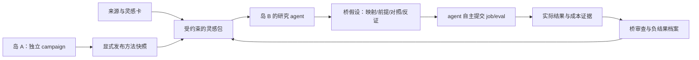

# 方法岛屿、可验证的桥与 AutoPostTrain 灵感输入

状态：**设计 + 首批 RED 契约 + 静态素材**；新研究层尚未实现。既有 job/eval/Ray 不受代码改动。本轮不运行研究实验、不调用额外模型、不宣称分岛有效。

## 要检验的问题

在相同总预算下，让有不同经验的研究路线显式交换方法，是否比集中共享、独立探索或随机交换更有效？若有效，收益能否改善下一轮在新任务族上的研究效率？

“不同模型聊天”“不同角色提示词”“更多资料”都不足以直接回答。模型可以共用基座，先用独立问题经验、方法档案与工具建立可观察差异；若行为没有差异，报告未测得专长。

## 对象和既有系统的关系

- **岛**：独立 campaign、成员、经验和方法档案；focus 是研究偏好，不限制 agent 只能做一种算法。
- **方法**：数据处理、课程、rollout、奖励适配、搜索、状态表示、研究工具或模型产物。模型 checkpoint 只是其中一种。
- **群岛**：同一控制服务下岛的集合，定义显式发布范围。首版不解决跨机构/跨部署联邦。
- **桥**：从源方法到目标任务的表示变换与验证计划，不是“把A的模型和B的模型平均一下”。模型结构/tokenizer/训练谱系不兼容时，不能直接合权重。
- **灵感卡**：源研究摘要 + 本项目迁移假设 + 可证伪小实验。不能自动变成训练数据，也不能自称已验证。
- **证据**：来自 job/eval、模型/数据快照和完整成本记录；仅聊天中说“提高10%”不能晋升方法。

现有同一 campaign 的成员默认共享全部记录，因此一岛一 campaign，靠已有成员权限保存独立历史。读取某个发布 capsule 不应自动开放源模型、原始笔记或完整实验日志。

## 第一批路线如何形成

可从四种偏好出发：数据与验证、学习与 rollout、搜索与课程、表示与系统。共同基础模型、工具和初始材料保持一致，独立预算和经历逐渐形成路线。名称不是指标，不强迫各岛永久固定角色。

观察差异时使用同协议下的能力向量、错误集合、行为/数据分布、程序方法谱系和成本，而非角色名或方法描述的词汇距离。尚无对齐测量时返回 null；不为了展示仪表盘虚构一个“多样性分数”。同义改写不算发现新路线。

## Agent 真正会获得什么

首版不是自动研究总指挥，而是可选的只读辅助输入。一次灵感包应回答：

1. 当前失败症状与哪些方法有关？来源是什么、核对到什么程度？
2. 迁移还缺哪些条件？模型、表示、框架、teacher政策和资源是否允许？
3. 最小改动是什么？对应哪项小实验和反证？
4. 已有哪些失败经验？能排除什么，不能推出什么？
5. 材料总上下文是否超过限额？未推荐项为什么被排除？

候选排序先做透明的标签/适用条件检索与方法去重，再保留少量不同机制的候选。以后可把向量检索或 LLM 选桥器作为对照；首版不承诺“语义相关=迁移有效”。

材料库可立即在 `research/inspiration/cards.json` 阅读，未来 API 才会自动推荐。所有8张卡的 local_validation=not_tested。来源核对说明在 sources.json；Athanor 使用此前读过的全文，其余6篇仅核对当前摘要。

## 一个具体例子：模型在工具轨迹中反复循环

目标岛观察到部署时贪心解码反复执行同一操作，但训练采样轨迹很少循环。灵感包可能提供：

- Athanor 的混合解码 rollout 案例（源论文发现），建议检查部署/训练分布差异（本项目假设）。
- MAP-Elites 的行为归档思想，建议保留“低循环/高准确”和“高分/高循环”两个不同候选，避免只看均分（迁移假设）。
- STaR 的自生成样本筛选思路，建议先验证生成问题和答案，再入训练池（迁移假设）。

桥假设必须写清：源 sampler 如何映射到目标接口、reward 是否一致、哪些表示不变量需要保留、生成/训练/评测token预算如何配齐。若只是缩短输出让循环减少但正确率下降，应记负结果。

此例不预设混合解码一定有效；若目标框架不能修改 rollout，应该排除相应卡并说明缺失条件。EDR/NDR/漏洞定位的例子也只是待验证迁移，Athanor没有给出这些场景的实验证据。

## 桥的最小记录

| 字段 | 用途 |
| --- | --- |
| source_method_id、target_island_id | 来源与目标，不凭空捏造方法 |
| mapping.source/target/invariants | 说明结构转换及保留条件 |
| preconditions | 模型/表示/框架/数据与教师限制 |
| hypothesis、minimal_trial | 说明为何可能有效，先试哪一小步 |
| equal_budget_control、falsifier | 排除额外计算，允许结论被推翻 |
| budget | 生成、检索、适配、失败、训练、评测的上限 |
| trial/job/eval/模型引用 | 与实际执行证据绑定 |
| validation_scope、failures | 区分模拟、开发测量、未验证观察与负迁移 |

提出桥不自动发 job；agent 仍可拒绝建议、修改程序或选择另一条路线。没有正式证据只能是 hypothesis 或 unverified_observation。review 缺独立等预算对照返回 inconclusive；不能把提案数量、共享次数或自报收益当成功迁移数。

后续晋升审查要测试：实际目标产物能否追到 job、协议/题目是否相同、控制与迁移起点是否可比、预算账目是否完整、重复试验是否支持收益、关键能力是否回归。统计范围要保留：simulated_dev 不等于真实后训练结果，开发证据不等于新任务族普遍规律。

## 四组研究设计

| 组 | 规则 | 要回答的问题 |
| --- | --- | --- |
| centralized | 相同初始方法，集中档案与共享经验 | 独立历史是否有增益？ |
| isolated | 各岛保留经验，不迁移方法 | 交流本身是否有增益？ |
| random_bridge | 在允许范围随机选源方法，拥有相同适配预算 | 随机迁移是否已足够？ |
| selective_bridge | 根据问题结构、条件和历史挑选方法 | 选择机制是否优于随机？ |

随机分配任务与种子，在看结果前固定协议、描述符、预算和选择/最终任务族。四组获得同样的初始材料与总资源；中央组不能人为少给上下文或适配能力。计入失败实验、检索、适配与模型调用，只有GPU时长而无token账目时不能声称同成本胜出。

发现正例后，再做移除迁入方法与同预算继续独立搜索的确认。报告负迁移和无显著结论，不能只挑成功桥。初轮CPU/Ray合成任务只验证数据流、调度、预算和测量逻辑，不能验证真实AI专长或科研突破。

RSI 的单独检验：第一阶段产出的工具/方法/选桥器更新，冻结后在全新任务族上比较下一轮有效实验率、单位成本收益或首次有效改进时间。仅存入更多资料不构成这项证据。

## 拟议操作（尚未实现）

`rsi request` 已存在，以下 operation 仍为设计：

- island.create/show、archipelago.create/diversity/report
- method.add/show/fork/publish
- idea.import/pack
- bridge.propose/show/record_failure/record_trial/review

`idea.import`：operator 导入来源与材料，固定id/version，内容改变要换版本。
`idea.pack`：target island、失败signals、实际能力capabilities、limit与context_budget_chars；输出context/cards/excluded、相关原因、来源与试验。
`method.publish`：仅放行可共享快照；源campaign权限保持不变。
`bridge.record_trial`：绑定角色明确的 baseline/control/transfer 试验及服务内job/eval收据，实际cost由账目取得；不能提交一个自报分数代替。

现有服务目前会对这些 operation 返回 UNKNOWN_OPERATION；首批契约因此红色失败。这轮没有写假的实现或让测试预期失败变绿。

## CI/CD 及阶段

已有基础与 Ray 测试继续运行。新增 research-islands-contracts job 显式运行 contracts/research_islands，保存 JUnit。该 job 在业务未实现前失败，因此 release/simulation delivery 暂时被阻止；不使用 skip/xfail/continue-on-error。

素材完整性测试在普通 tests 内，应通过。后续逐步实现库、岛、桥、证据审查和对照runner；CI绿灯只表示软件契约通过，不是“岛屿研究已证明有效”。远端 GitHub Actions 本轮没有触发。

参考范围：[POET](https://arxiv.org/abs/1901.01753v3)的跨环境中间策略迁移、[MAP-Elites](https://arxiv.org/abs/1504.04909v1)的行为档案、[AlphaEvolve](https://arxiv.org/abs/2506.13131v1)的程序执行反馈、[DGM](https://arxiv.org/abs/2505.22954v3)的agent版本档案、[S4](https://arxiv.org/abs/2111.00396v3)的结构化状态空间与[STaR](https://arxiv.org/abs/2203.14465v2)的生成/筛选/微调。具体 AutoPostTrain 与安全迁移由本项目提出，未被这些来源直接验证。
