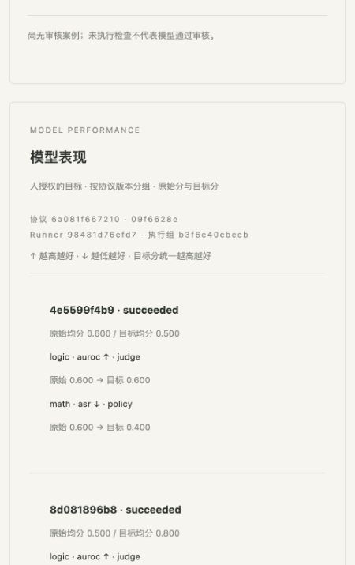

# Benchmark Runner 实现与验收

已获用户“开始实现”授权，基于 e845f7b 的 OpenSpec、48 项 RED 与 CI 门禁实现。16 项任务完成，未自动归档 change。本次 Runner 门禁已通过；整库仍有原有失败和排队作业，详见下面的远端记录。

## 已完成的行为

- operator 注册不可变 Runner：核对完整 Git HEAD、origin、dirty 状态及导出内容摘要，文件进入校验 blob。执行不读取原 checkout；错误/损坏内容拒绝执行。code/model judge 与固定协议匹配；模型 judge 的 artifact 和模板内容均校验。
- `eval submit --runner ID --model ID` 异步返回，执行前固化完整 run-config；local/Ray 走受管执行器，内部评测不作为公共 job 暴露。
- 保存实际 Python/包清单、实际命令、启动/完成/退出/信号/超时/调度诊断、逐题预测/raw 得分和有界日志快照。失败/取消保留已有证据；旧 eval 不伪造配置。
- 严格 JSONL 全题校验，非零退出/缺题/重复/未知题/非法 JSON/NaN 整次失败。服务按人授权 direction 计算 normalized 分，不信任外部 normalized 字段。
- 比较、聚合、候选选择、提交按协议/Runner/实际环境组约束，允许显式选择组。旧审核 pass 不能放行新 Runner；case 绑定实际 eval 和配置。GPU 预留/使用与训练共享，换 Runner 不重置 query 预算。
- 请求路径不运行模型；重启找回稳定任务 ID。未知远程写结果只查询、不重发；本地已启动 worker 丢失明确失败。取消竞态不覆盖取消；worker 按时完成不会因控制面晚轮询被误判超时。
- show/list/model/compare/events/HTTP/看板只显示安全摘要，隐藏 Runner 不向研究者列出。私有 config/samples/logs 仅 operator；secret 只存 env 引用，使用引用时不保存外部子进程 stdout/stderr。

## 实际验证

| 检查 | 结果 |
|---|---|
| 原已实现功能回归 | 315 项通过 |
| Runner CPU 契约（含 CLI/HTTP/权限/恢复） | 77 项通过 |
| 真实 Ray CPU（原 15 + 新 3） | 18 项通过 |
| ruff / OpenSpec strict / sdist+wheel | 通过 |
| 仓库外干净 wheel：训练 runtime+venv+产物 | 通过 |
| 仓库外干净 wheel：两 checkpoint 外部 Runner 重放 | 通过 |
| 干净安装 demo | 0.5 → 1.0，通过 |
| 实际浏览器 researcher 看板 | Runner/执行组、↑/↓、role、raw/目标分显示一致，无题目/路径/预测 |

本地组合命令最终为 **392 passed**（315 原有 + 77 Runner），真实 Ray 组合为 **18 passed**。

新契约从 46 CPU+2 Ray 扩到 77 CPU+3 Ray。新增故障测试先观察到本地丢 worker、凭证 stdout、Ray job lost、晚轮询误超时、零 CPU/空参数、分离式凭证参数等 RED 后修复；其余新增回归检查直接保持 GREEN。预算测试的 helper 名与旧 campaign 数据引用有两次测试夹具错误，已改用实际 `job_request(datasets=[])`，未弱化预算断言。原始 RED 报告未覆盖。

## 两个 checkpoint 的重放证据

`smoke_installed_runner.py` 在不导入源码树/测试 helper 的干净安装环境执行外部 stdlib driver，原 checkout 删除后仍成功：

| 模型 | math raw ↓ | logic raw ↑ | raw 均分 | normalized 均分 |
|---|---:|---:|---:|---:|
| A | 0.6 | 0.6 | 0.6 | 0.5 |
| B | 0.2 | 0.8 | 0.5 | 0.8 |

两次 run_config_digest 不同，comparison_digest 相同；`eval.compare` delta=+0.3，campaign.select 选择 B。模型文件是假权重，分数来自 fixture，**这是执行/记录链路验证，没有真实模型推理或 GPU 测量**。具体 ID/digest 在同名 JSON 报告，完整私有记录在本机临时验收目录。

## 已知边界

- 原研究小岛 change 仍为 **32 RED、2 GREEN**，未修改、未 skip/xfail，继续阻断完整 CI 和 release。
- H100 不可访问，本轮未占用真实 GPU。真实 bench 评分/推理由 operator 的冻结 driver 提供，框架没有实现各安全 benchmark 的 evaluator。
- Ray 要求同一私有共享绝对文件根；不提供多节点传输。GPU 秒是 driver 时长估算，不覆盖动态 child actors；镜像标签没有升级为运行镜像证明。
- 同 Unix 用户 API 权限不是强安全沙箱。重复评测仍使用冻结 seed，不宣称独立抽样。
- 终态日志快照上限 10000 行/1MiB；更早诊断未形成实际环境/退出证据时，收据如实保留空缺。

使用方式与完整 schema：[docs/benchmark-runners.md](../docs/benchmark-runners.md)。

## GitHub CI 留证

实现提交 `0270d54`，凭证参数补丁提交 `1783352`，均已推送 main。最新实现对应 [CI run 40349120025](https://github.com/wzk2239115/rsi-red/actions/runs/40349120025)：

- Runner CPU 矩阵（Ubuntu + macOS）完整通过；[真实 Ray Runner](https://github.com/wzk2239115/rsi-red/actions/runs/40349120025/job/121664012596)通过。
- 原 Ray、自由训练 CPU 矩阵/真实 Ray、审核、轻量 peers 门禁通过。
- 原 research-islands 门禁失败；方向矩阵完成 1/2，基础回归矩阵完成 2/4，其余仍 queued。**不声称整库 CI/CD 全绿或已发布**。
- REST API 公共配额耗尽后，使用 GitHub 公开 run 页面和矩阵状态核对，未注入凭证或绕过 gate。完整观察状态与时间保存在同名 JSON；这些是已观察状态，不代表排队作业的最终结果。

报告提交只更新文档/证据；上面的 run 固定到实现提交，后续 GitHub 自动运行继续受全部门禁约束。
