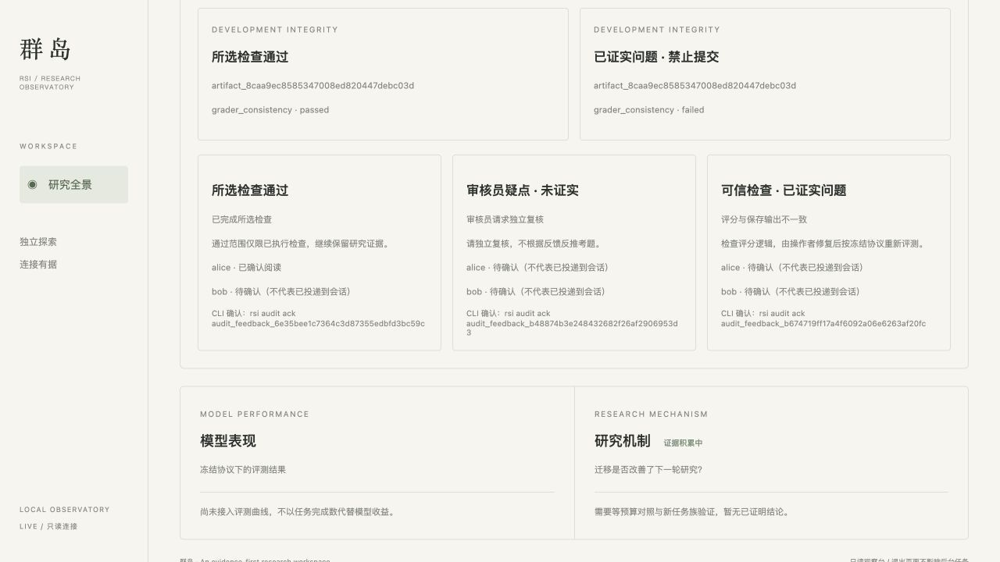

# 独立审核实现验收（2026-10-26）

用户授权后按OpenSpec → RED/CI → 编码推进，新增33项审核契约现已GREEN。最初13项RED保留；隐私扩展阶段24项中23失败、1项既有投影通过，后续接口/后台/看板/身份及收据负例在实现前逐项记录RED。没有skip/xfail或删除原断言。

## 已交付

- operator配置不可变policy；第五auditor为平级只读摘要/追加疑点身份，不具备训练/评分器/配置权限。
- case冻结模型、开发协议、eval和策略摘要；异步检查、幂等请求、campaign案例与开发eval查询预算。
- 显式exact_match时独立重算已保存输出得分；可信收据记录代码摘要、输入绑定、seed、范围、时间和额外推理调用数0。逐题证据只供operator读取，不给auditor/训练者。
- 最终提交门禁要求当前策略、同模型与协议的通过案例；高分/文字声明/客户端伪造收据不能放行。
- protocol.show默认元数据；eval.model/eval.show白名单开发汇总；eval.samples仅operator；held-out不进入审核反馈。
- 线索原文私有保存；训练者获得固定类别与建议，区分suspected、confirmed_issue、incomplete、checks_passed；事件/分页游标/独立ack持久化和重启恢复。
- 看板安全投影与确认状态；ray-peers --with-auditor离线初始化；研究技能与使用文档同步。

原有两个eval.samples诊断测试改成operator调用，同时增加训练者拒绝断言。这是用户要求防泄题导致的明确权限变更，不是删除诊断验收。看板只读调用集合增加audit.list和audit.feedback并保留其他断言。

## 验证

- 本地行为/进程/审核/部署/CLI契约：204 passed。
- 其中审核契约33项；错误输出被记为高分的确定性反例被拦截，正常exact-match判分通过。
- 真实Ray Jobs CPU集成：10 passed，67.15秒；未提交GPU任务。
- ruff、OpenSpec strict、构建通过；全新venv安装wheel后验证audit/model帮助、可选五身份初始化和CPU demo。
- 真实HTTP后台reconciler与subprocess CLI查评测通过，不依赖直接调用reconcile才能完成。
- 浏览器用CPU fixture检查通过/疑点/已证实反馈、独立ack与长ID换行；图中alice/bob是测试身份，不是已启动的研究会话。

## 当前边界

format_robustness/data_overlap执行器未接入，必需检查缺失时incomplete，不伪造pass。exact_match不是语义、代码、环境或真实模型鲁棒性复评；实际生产evaluator仍需接入。真实harness会话创建/投递/唤醒尚无适配器，CLI可主动读反馈，watch只验证到通知handler。用户明确本版优先打磨infra，物理隔离后续另行验收。

既有research-islands-and-inspiration仍有32项RED，未在此任务实现或绕过；因此整体发布CI仍可能被该既有门禁阻断。审核CI单独运行并保留JUnit。不得将本轮局部GREEN描述成整仓所有未来契约完成。

## 线上CI补充定位

审核独立CI与Ubuntu 3.12/3.13回归首先通过；macOS既有启动测试出现10秒就绪超时。新增可执行RED证明HTTPServer默认反向DNS依赖，改为loopback专用监听器，控制服务与看板共用，不放宽原就绪期限。CI补充JUnit失败注解，避免只有退出码。线上Ray首跑失败缺少详细注解，补诊断后的重跑10项通过；尚不能据此确认首次失败根因。最终线上状态以对应GitHub Actions run为准。
