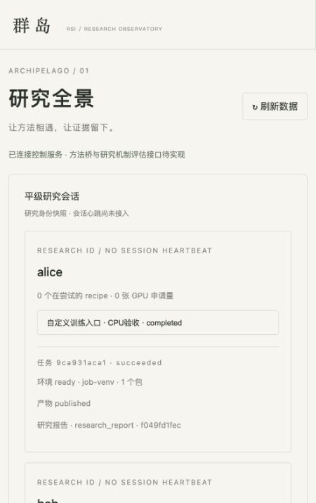

# 开放训练执行验收（2026-10-26）

change：flexible-training-execution。用户审阅spec与RED/CI后授权实现；原始RED报告未覆盖或删除。

## 已实现

- job.validate与submit共享权限/输入/资源/预算校验；无事件/任务/快照/调度副作用，幂等重试预检不重复计算资源。CPU后端预检即拒绝GPU请求。
- 任意method/argv/训练reward继续开放；runtime/execution控制字段拼错或未支持拓扑明确拒绝。没有方法白名单与逐实验审批。
- 修复普通max_tokens/tokenizer参数脱敏误伤及请求幂等摘要碰撞；真正凭证仍不回显。
- 冻结requirements字节；任务可指定Python；local/Ray共用标准库runner，Ray直接分发runner源码，不依赖私有venv安装rsi-red。
- 私有venv安装、实际Python/包清单与摘要；准备、训练、收集共用deadline；失败不进入trainer，取消仅操作当前任务。默认清理worker继承PYTHONPATH等注入，显式用户配置仍记录并保留。
- 运行期manifest支持文件/目录和任意kind；旧model严格检查保留。内容复制、摘要验证、原子发布、重启恢复和服务确认来源；CLI job.outputs可查询。
- 默认正式协议只接受model，operator可冻结artifact_kinds明确支持的类型；研究报告不会被误当模型取得fixture得分。
- 看板只投影环境状态/包数量/产物状态，不发送原始变量、包清单或绝对路径；研究skill与运行文档同步。

## 验证结果

- 本地已实现回归、审核、部署、开放训练与CLI：254 passed。
- 真实Ray Jobs CPU：15 passed（91.53秒），包括原10项与新增5项。
- 新增执行边界包括离线双版本wheel各用独立venv、冲突PYTHONPATH不能覆盖任务依赖、准备阶段walltime、requirements源改写、无效依赖不运行trainer。
- 实际Ray验证显式任务Python优先、Shell和两个CPU子进程launcher、私有环境、输出回传；新控制器/新SDK客户端在发布前恢复同一个Ray任务，不重训、不重复发布。
- 发布的后一个输出不完整时原子撤回本批artifact；训练exit_code=0仍正确报告收集失败。
- 干净venv安装wheel后验证CLI/profile、真实私有环境和产物发布、CPU demo；构建/ruff/OpenSpec strict通过。
- 浏览器窄屏验收成功。截图是alice/bob CPU fixture，不是已启动的真实研究会话。

## 测试说明

控制契约的外部Scheduler double新增supports_runtime/outputs声明；真实Ray head fixture显式shared_filesystem=true，以符合已审阅的共享文件根前提。它们只描述外部能力，不替代产品环境准备或产物逻辑。保留所有原断言，未使用skip/xfail/continue-on-error。新增测试有实际RED后转GREEN，也保留已实现能力自然GREEN，不为制造全红而更改正确行为。

## 当前边界

本版仅单节点command；共享文件根是操作者声明，非自动证明物理隔离或跨主机传输。未声明时runtime/outputs拒绝；Slurm/Kubernetes的新功能尚未支持，旧任务兼容。动态Ray子资源和多节点尚未完整管理。环境清单不是完整镜像锁定，安装时间计入资源与walltime。

没有访问H100或运行真实GPU训练；tasks 5.3保留未验收。未配置的真实evaluator、格式扰动/data-overlap检查器、实际harness会话投递仍是既有独立缺口。旧research-islands的32项RED保留，整体发布不因本次局部GREEN绕过该门禁。线上CI结果以对应GitHub Actions run为准。
